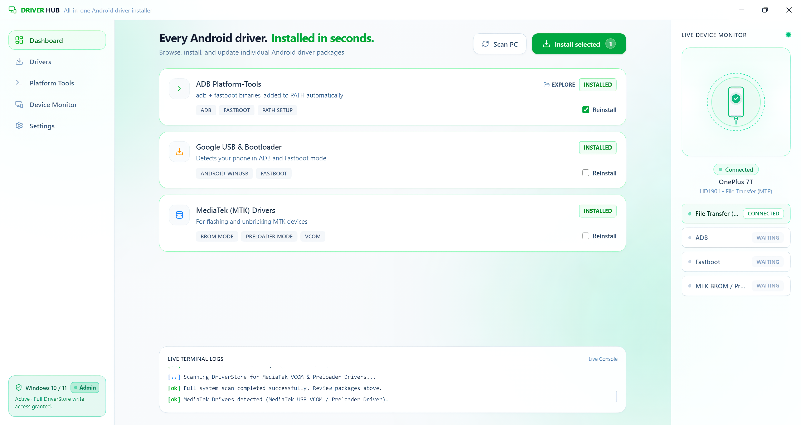
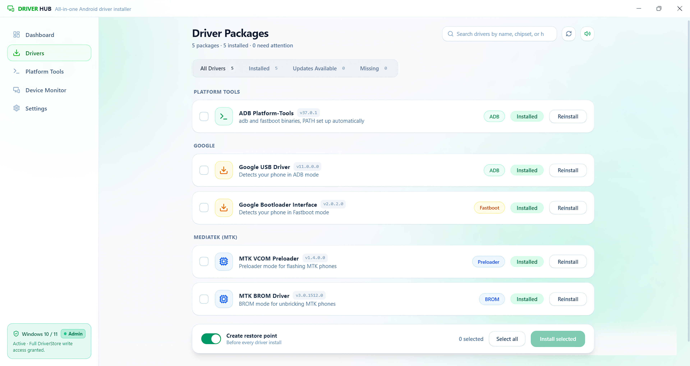
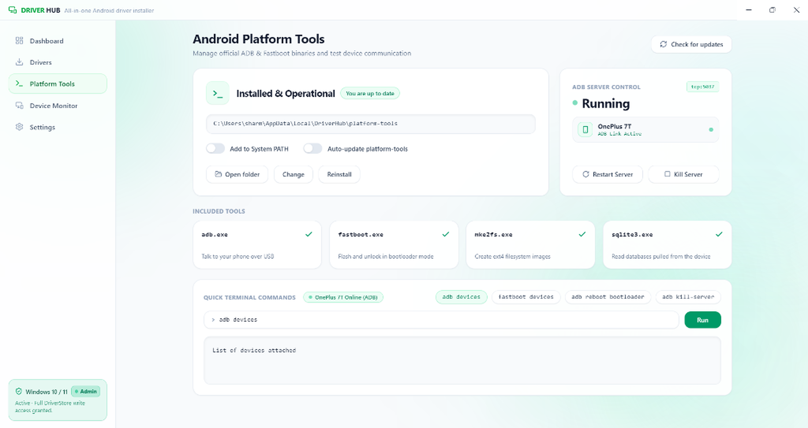
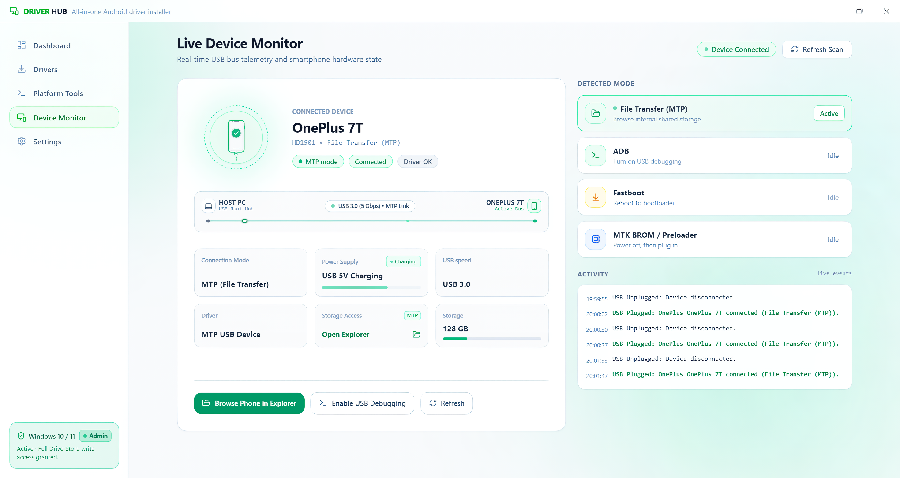
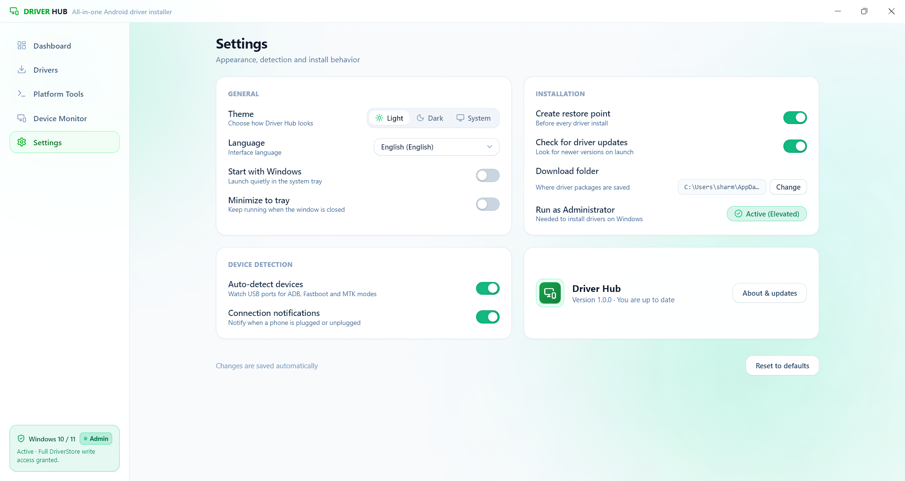
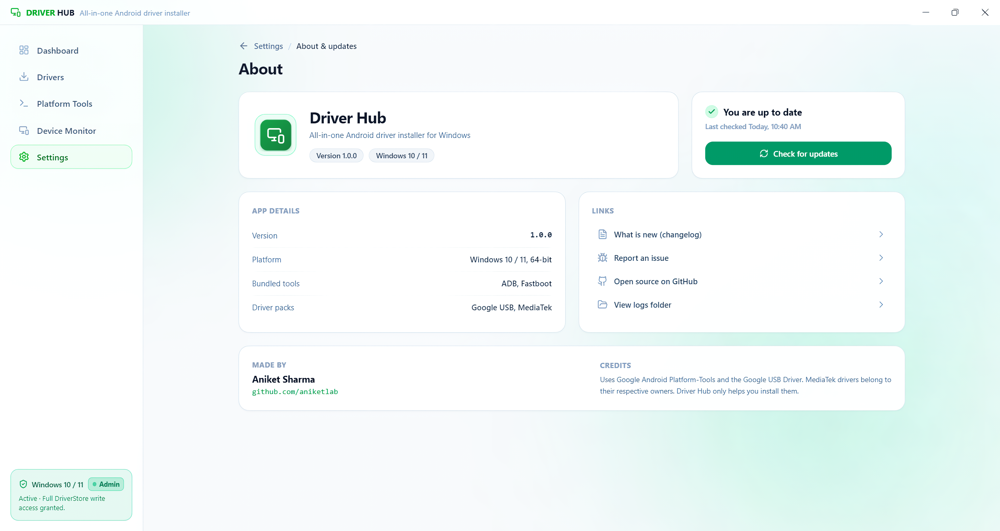
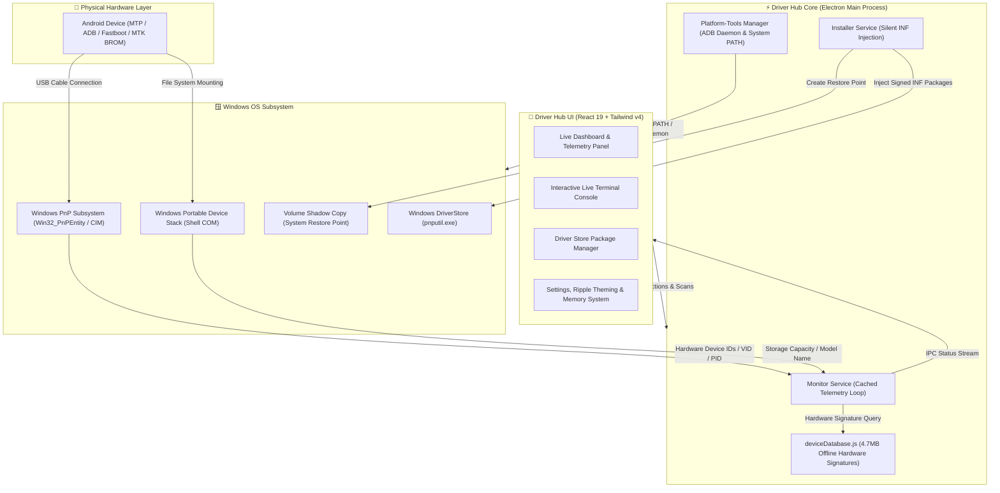

<div align="center">


### The Modern, High-Performance Android Driver Suite & Hardware Diagnostic Hub for Windows

<p align="center">
  <a href="https://github.com/aniketlab/DriverHub/releases/latest"></a>
  <a href="https://github.com/aniketlab/DriverHub/actions/workflows/build.yml"></a>
  <a href="https://github.com/aniketlab/DriverHub/releases"></a>
  <a href="LICENSE"></a>
</p>

<p align="center">
  
  
  
  
  
  
</p>

<br />

<p align="center">
  <a href="https://github.com/aniketlab/DriverHub/releases/latest"><b>⬇️ Download Latest Installer</b></a> •
  <a href="#-quick-start"><b>🚀 Quick Start</b></a> •
  <a href="#-key-features"><b>✨ Key Features</b></a> •
  <a href="#-interface-walkthrough"><b>📸 Interface Tour</b></a> •
  <a href="#-why-driver-hub"><b>⚔️ Comparison</b></a> •
  <a href="#-building-from-source"><b>💻 Build Guide</b></a>
</p>

---

</div>

<br />

## 🌟 Overview

**Driver Hub** is an open-source, enterprise-grade desktop utility purpose-built for Android enthusiasts, mobile repair technicians, and developers. It completely eliminates the chaos of searching shady forums, ad-bloated file hosts, and broken executable installers to get your Android device recognized on Windows.

Driver Hub directly communicates with the **Windows DriverStore** via native `pnputil`, safeguards your operating system using **automatic Windows System Restore Points**, provides real-time **hardware telemetry** for connected phones (MTP, ADB, Fastboot, MediaTek BROM/Preloader), and integrates the official **Google Platform-Tools** environment with a single click.

<br />

<div align="center">
  
  <p><em>Driver Hub Live Telemetry Dashboard & Hardware Diagnostic Panel</em></p>
</div>

<br />

---

## ⚔️ Why Driver Hub?

| Pain Point | The Old Traditional Way ❌ | The Driver Hub Way ⚡ |
| :--- | :--- | :--- |
| **Driver Hunting** | Searching sketchy blogs, Mediafire links, and ad-filled sites | **Curated, digitally signed OEM driver packages included** |
| **OS Safety** | Random `.exe` files risk system stability and malware | **Automatic Windows System Restore Points before installation** |
| **Driver Installation** | Manual `.inf` right-clicks and broken Device Manager steps | **Direct native Windows DriverStore injection via `pnputil`** |
| **Device Recognition** | Guessing port names or yellow exclamation marks in COM ports | **Live USB Bus monitoring with 4.7MB offline device database** |
| **ADB & Fastboot** | Downloading 300MB ZIPs and manually editing System `PATH` | **Pre-bundled binaries + 1-Click System PATH synchronization** |
| **User Experience** | Outdated Windows XP-era utility interfaces | **Modern Acrylic/Mica Glassmorphic UI with Fluent physics** |

<br />

---

## ✨ Key Features

### ⚡ 1. One-Click DriverStore Injection
- **Native `pnputil.exe` Engine**: Packages are injected directly into the Windows DriverStore with full system catalog verification. Zero messy third-party wrappers or adware.
- **Comprehensive OEM Coverage**:
  - **Google USB Drivers**: Universal ADB & Bootloader/Fastboot support for Google Pixel, Nexus, and standard AOSP devices.
  - **MediaTek (MTK) USB Drivers**: Full support for BROM mode, Preloader mode, and high-speed MTK USB VCOM flashing ports.
  - **Motorola & Universal OEM Drivers**: Extended support for Motorola, Xiaomi, OnePlus, and generic Android interfaces.
- **Silent & Reliable**: Zero mandatory system reboots for modern Plug-and-Play USB devices.

### 🛡️ 2. Fail-Safe Windows System Restore Protection
- **Automatic Restore Point Creation**: Before any driver package or system variable is modified, Driver Hub triggers a native Windows Volume Shadow Copy (VSS) restore point.
- **Zero Risk Guarantee**: Experiment with custom ROMs, flashing tools, and kernel debuggers with total peace of mind.

### 📱 3. Real-Time Hardware Telemetry & Intelligence
- **High-Speed Hardware Polling**: Sub-second, non-blocking polling engine monitors physical USB bus attachment events without UI freezing.
- **Instant Mode Detection**:
  - `File Transfer (MTP)`: Windows Portable Device enumeration with storage capacity analysis.
  - `ADB Debugging`: Android Debug Bridge status with authorization check and dynamic property caching.
  - `Fastboot Mode`: Bootloader lock status inspection (`Locked 🔒` / `Unlocked 🟢`), userspace (`FastbootD`) detection, and product tag.
  - `MediaTek BROM / Preloader`: Flashing handshake port recognition with instant yellow-mark driver diagnostics.
- **4.7MB Offline Device Database**: Resolves raw USB Vendor IDs (VID) and Product IDs (PID) into friendly commercial names (e.g. `OnePlus 7T`, `Redmi Note 10`, `Samsung Galaxy S23`).

### 🛠️ 4. Google Platform-Tools (SDK) Environment
- **Pre-Bundled Google Binaries**: Official `adb.exe`, `fastboot.exe`, and companion dependencies ready out-of-the-box.
- **1-Click System PATH Sync**: Permanently adds platform-tools to the Windows environment `PATH` with instant registry broadcast.
- **Daemon Process Controller**: Start, terminate, or restart the background `adbd` server on port `5037` with one click.
- **Embedded Interactive Terminal**: Execute adb and fastboot shell commands directly within Driver Hub with live syntax-colored logs.

### 🎨 5. Next-Generation Design & Ergonomics
- **Glassmorphic Aesthetics**: Frosted acrylic surfaces, ambient emerald status glow, and sleek responsive layouts.
- **Circular Ripple Theme Engine**: View Transition API wave animation expanding outward from the theme toggle.
- **Ultra-Slim Custom Scrollbars**: 6px floating rounded pills with 100% transparent tracks and zero legacy arrow buttons.
- **Persistent Memory Engine**: Dual-layer state persistence ensures all user toggles, preferences, and window positions are remembered across app restarts.
- **Universal Scroll Reset**: Navigating across tabs automatically restores each section clean from the top.

<br />

---

## 📸 Interface Tour & Module Previews

<details open>
<summary><b>🖼️ Click to expand / collapse the full visual tour</b></summary>

<br />

<div align="center">

### 1. Driver Packages & Automated Store Management
*Categorized OEM driver packages with automatic System Restore Point protection.*


### 2. Android Platform-Tools (SDK) & ADB Console
*Built-in ADB and Fastboot binaries, 1-click Windows System PATH integration, and live terminal.*


### 3. Real-Time Hardware Diagnostic Hub
*Deep USB connection pipeline analysis, battery telemetry, and internal storage inspection.*


### 4. Settings, Theming & Preferences
*Light/Dark theme toggles, background device polling controls, and system administrator elevation.*


### 5. About & Developer Credits
*App versioning, build info, open-source licensing, and maintainer credits.*


</div>

</details>

<br />

---

## 🏗️ System Architecture



<br />

---

## 📱 Hardware & Chipset Compatibility Matrix

Driver Hub has been tested and certified across a comprehensive range of mobile chipsets:

| Chipset Family | Manufacturer | Modes Supported | Primary Use Case |
| :--- | :--- | :--- | :--- |
| **MediaTek Dimensity / Helio** | MediaTek | BROM, Preloader, VCOM, Fastboot, ADB | SP Flash Tool, MTK Client, Firmware Unbrick |
| **Snapdragon (All Generations)** | Qualcomm | Fastboot, FastbootD, ADB, MTP | Bootloader Unlocking, Custom ROMs, Kernel Debug |
| **Google Tensor / Exynos** | Google / Samsung | Fastboot, FastbootD, ADB, MTP | Android Platform Development, OTA Updates |
| **Unisoc / Spreadtrum** | Unisoc | SPD Diag, Fastboot, ADB, MTP | Research Download Tool, Recovery Flashing |
| **Kirin / HiSilicon** | Huawei | Fastboot, ADB, MTP | Multi-Tool, Fastboot Commands |

<br />

---

## 🚀 Quick Start (For End Users)

### Method 1: Windows Installer (Recommended)
1. Download the latest installer from the **[Releases](https://github.com/aniketlab/DriverHub/releases/latest)** page:
   ```text
   Driver-Hub-Setup-1.0.0.exe
   ```
2. Run the setup and grant Windows Administrator permissions when prompted.
3. Launch **Driver Hub** from your Desktop or Start Menu.
4. Plug in your Android device via USB and click **Scan PC**!

### Method 2: Portable Executable
1. Download `Driver-Hub-1.0.0-portable.exe` from [Releases](https://github.com/aniketlab/DriverHub/releases/latest).
2. Run anywhere—no installation or system footprint required.

<br />

---

## 💻 Building From Source (For Developers)

### 1. Prerequisites
- **Node.js**: `v18.x`, `v20.x`, or `v22.x+` ([Download Node.js](https://nodejs.org/))
- **npm**: Comes bundled with Node.js
- **Git**: Installed and configured on your machine
- **Windows PowerShell**: PowerShell 5.1 or PowerShell 7+

### 2. Clone Repository
```bash
git clone https://github.com/aniketlab/DriverHub.git
cd DriverHub
```

### 3. Install Dependencies
```bash
npm install
```

### 4. Development Mode (with Hot Module Replacement)
```bash
npm run dev
```

### 5. Production Compilation
Compile the React 19 frontend:
```bash
npm run build:vite
```

Generate the Windows NSIS installer and portable executable in `dist-electron/`:
```bash
npm run build:electron
```

Or run the complete automated build pipeline:
```bash
npm run build
```

<br />

---

## 📁 Repository Directory Structure

```text
DriverHub/
├── .github/
│   ├── ISSUE_TEMPLATE/       # Interactive bug report & feature request forms
│   ├── workflows/            # GitHub Actions CI/CD release & build pipeline
│   ├── CONTRIBUTING.md       # Developer contribution guidelines
│   └── PULL_REQUEST_TEMPLATE # Contributor PR checklist
├── assets/
│   ├── logo/                 # Brand SVG vectors, high-res PNG icons, and logos
│   └── screenshots/          # 4K crisp visual tour and interface previews
├── electron/
│   ├── bin/
│   │   ├── drivers/          # Certified OEM driver packages (Google, MTK, Motorola)
│   │   └── platform-tools/   # Official Google ADB & Fastboot binary distribution
│   ├── data/
│   │   ├── deviceDatabase.js # Hardware VID/PID parser and brand resolver
│   │   └── devices_db.json   # 4.7MB database of known Android hardware signatures
│   ├── services/
│   │   ├── detectDevices.ps1 # Sub-second Windows PnP & WPD hardware query script
│   │   ├── installerService  # Native pnputil.exe driver injection engine
│   │   ├── monitorService.js # Resilient background device polling loop
│   │   ├── pathService.js    # Windows System PATH environment sync manager
│   │   └── restoreService.js # Native Windows System Restore Point creator
│   ├── main.js               # Electron lifecycle, IPC handlers, and window management
│   └── preload.js            # Secure contextBridge API exposing native functions
├── src/
│   ├── components/           # Modular React components (Dashboard, Drivers, Tools, Settings)
│   ├── data/                 # Driver metadata, changelogs, and translations
│   ├── App.jsx               # Primary application state, navigation, and theme orchestrator
│   └── index.css             # Tailwind CSS v4 styling, custom scrollbars & glassmorphism
├── LICENSE                   # Open-source MIT License
├── package.json              # Project dependencies, scripts, and build metadata
└── README.md                 # Primary documentation and repository showcase
```

<br />

---

## 🤝 Contributing

Contributions make the open-source community an amazing place to learn, inspire, and create. Any contributions you make are **greatly appreciated**!

1. Fork the Project
2. Create your Feature Branch (`git checkout -b feat/AmazingFeature`)
3. Commit your Changes (`git commit -m 'feat: Add AmazingFeature'`)
4. Push to the Branch (`git push origin feat/AmazingFeature`)
5. Open a Pull Request

<br />

---

## 📄 License

Distributed under the **MIT License**. See [`LICENSE`](LICENSE) for more information.

<br />

---

## 👨‍💻 Author & Maintainer

<p align="center">
  Crafted with ❤️ by <strong>Aniket Sharma</strong><br />
  <a href="https://github.com/aniketlab"><strong>@aniketlab</strong></a>
</p>

<p align="center">
  <a href="https://github.com/aniketlab/DriverHub/stargazers"></a>
  <a href="https://github.com/aniketlab/DriverHub/network/members"></a>
  <a href="https://github.com/aniketlab/DriverHub/watchers"></a>
</p>

<p align="center">
  <em>If Driver Hub saved you time or solved your driver headaches, consider giving this repository a ⭐ star!</em>
</p>
